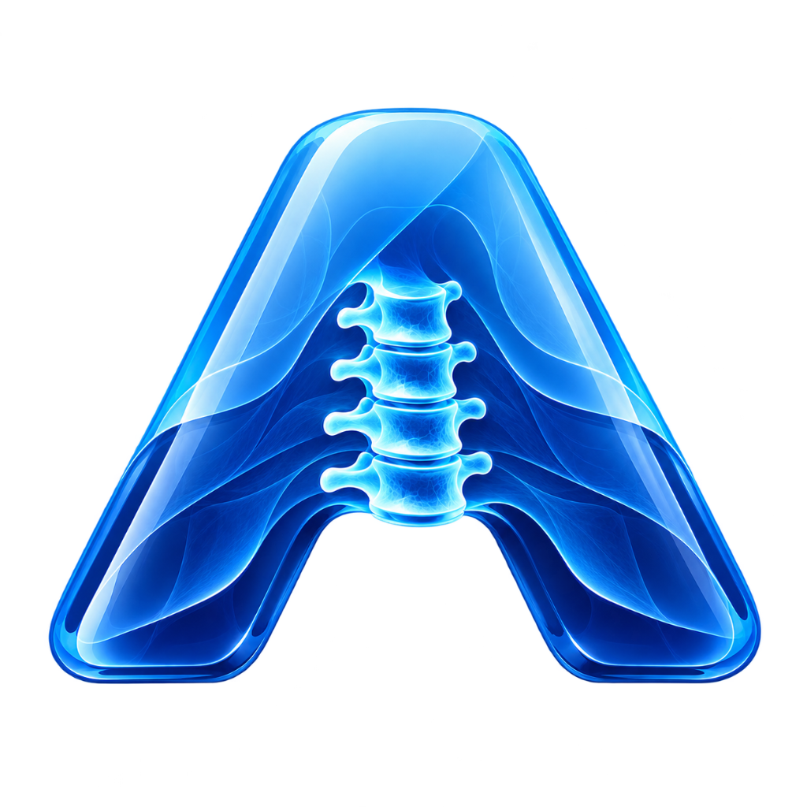

# ANATOMIX — Platform Edukasi Anatomi 3D Medis & Review Medis Adaptif

<p align="center">
  
</p>

<p align="center">
  <strong>Pendamping Belajar Cerdas Terintegrasi Kurikulum Preklinik Kedokteran</strong><br />
  Atlas Anatomi 3D WebGL • AI Study Planner • Rangkuman Kuliah Cerdas • Spaced Repetition • PWA Ready
</p>

<p align="center">
  
  
  
  
  
</p>

---

## 📖 Tentang ANATOMIX

**ANATOMIX** adalah platform web pendamping belajar adaptif yang dirancang khusus untuk mahasiswa kedokteran tahun awal (preklinik). 

Mahasiswa kedokteran menghadapi beban kognitif yang sangat tinggi menjelang ujian blok anatomi — ribuan struktur miologi, osteologi, vaskularisasi, dan inervasi yang sulit dipahami hanya melalui gambar atlas 2D konvensional. ANATOMIX hadir menjembatani tantangan tersebut dengan menggabungkan **Visualisasi Anatomi 3D Interaktif 6 Regio Tubuh** dengan **Asisten Belajar Cerdas Adaptif**.

### ✨ Masalah & Solusi
* **Tantangan Spasial**: Membayangkan relasi 3 dimensi antara otot, pembuluh darah, dan organ dalam tubuh manusia sulit dipelajari dari buku cetak.
  * *Solusi*: **Atlas 3D WebGL** dengan kontrol rotasi 360°, zoom, isolasi struktur, dan pemilihan regio (*Caput, Collum, Thorax, Abdomen, Pelvis, Membrum*).
* **Beban Hafalan Tinggi (Burnout & Cramming)**: Sistem blok seringkali memicu kram belajar semalam sebelum ujian praktikum (OSPE) maupun MCQ.
  * *Solusi*: **AI Study Planner** yang otomatis membagi beban target belajar harian terukur berdasarkan tanggal ujian blok.
* **Materi Kuliah yang Tercecer**: Slide kuliah ratusan halaman menyulitkan ekstraksi poin kritis.
  * *Solusi*: **Unggah Materi & Rangkuman AI** yang menyajikan tabel istilah Latin, korelasi klinis (OSCE), dan daftar struktur penting.
* **Lupa Cepat (Forgetting Curve)**: Struktur anatomi yang jarang diulang cepat terlupakan.
  * *Solusi*: **Spaced Repetition & Flashcard Adaptif** yang otomatis menjadwalkan repetisi lebih sering untuk struktur yang dinilai sulit/lemah.

---

## 🚀 Fitur Utama

| Fitur | Deskripsi | Rute Halaman |
| :--- | :--- | :--- |
| **Landing Page** | Showcase kurikulum FK, preview atlas tubuh manusia, dan penjelasan cara belajar adaptif | `/` |
| **Autentikasi Mahasiswa** | Form masuk & daftar akun, tips uji coba demo, serta dukungan PWA | `/masuk` |
| **Onboarding Wizard** | Pengaturan awal target topik blok (misal: Thorax/Kardiorespirasi), tanggal ujian, dan alokasi waktu harian | `/onboarding` |
| **Beranda (Dashboard)** | Ringkasan target belajar hari ini, metrik pemahaman regio, streak belajar, dan navigasi cepat | `/beranda` |
| **Perencana Belajar (AI Planner)** | Jadwal harian yang terdistribusi otomatis hingga hari-H ujian blok lengkap dengan pelacak kepatuhan | `/perencana` |
| **Materi & Rangkuman AI** | Modul unggah berkas PDF/slide kuliah dengan simulasi ekstraksi rangkuman klinis cerdas | `/materi` & `/materi/[id]` |
| **Latihan Soal Adaptif** | Bank soal pilihan ganda berstandar MCQ kedokteran dengan pembahasan klinis instan | `/latihan-materials` |
| **Flashcard Interaktif** | Kartu hafalan bolak-balik dengan klasifikasi tingkat kesulitan (Mudah, Sedang, Sulit) | `/flashcard` |
| **Atlas Anatomi 3D** | Mesin WebGL interaktif 6 regio tubuh manusia dengan kontrol orbit kamera dan deskripsi Latin | `/anatomi` |
| **PWA (Progressive Web App)** | Tombol instalasi langsung ke layar utama perangkat (laptop & HP) dengan kemampuan offline caching | *Tersedia di sidebar & topbar* |

---

## 🛠️ Tech Stack

- **Framework**: [Next.js](https://nextjs.org/) (App Router, Turbopack)
- **Bahasa**: [TypeScript](https://www.typescriptlang.org/)
- **Visualisasi 3D**: [Three.js](https://threejs.org/), [@react-three/fiber](https://r3f.docs.pmnd.rs/), [@react-three/drei](https://github.com/pmndrs/drei)
- **Styling**: [Tailwind CSS](https://tailwindcss.com/) & Modern CSS Glassmorphism
- **Ikonografi**: [Lucide React](https://lucide.dev/) & [Bootstrap Icons](https://icons.getbootstrap.com/)
- **Grafik & Analitik**: [Recharts](https://recharts.org/)
- **Demo Video Suite**: [Remotion](https://www.remotion.dev/) (Code-driven motion graphics video engine)
- **PWA**: Service Worker kustom (`public/sw.js`) & Web App Manifest (`manifest.ts`)

---

## 💻 Panduan Instalasi & Menjalankan Proyek

Pastikan Anda telah menginstal **Node.js** (versi 18.18+ atau versi 20 LTS disarankan) dan Git pada perangkat Anda.

### 1. Kloning Repositori
```bash
git clone https://github.com/mohamadarif03/anatomix.git
cd anatomix
```

### 2. Instal Dependensi
```bash
npm install
```

### 3. Jalankan Development Server
```bash
npm run dev
```

Buka peramban (browser) dan akses alamat:
```
http://localhost:3000
```

### 4. Build untuk Lingkungan Produksi
Untuk menguji hasil build produksi yang telah dioptimasi:
```bash
npm run build
npm start
```

---

## 🧭 Struktur Direktori Proyek

```text
anatomix/
├── public/                 # Aset statis, ikon, logo 3D, dan Service Worker PWA
│   ├── anatomix-logo.png   # Logo resmi 3D ANATOMIX
│   ├── logo-square.png     # Logo ikon persegi
│   ├── sw.js               # Service Worker untuk fitur PWA & offline
│   └── ...
├── src/
│   ├── app/                # Halaman Next.js App Router
│   │   ├── page.tsx        # Landing Page
│   │   ├── masuk/          # Halaman Login & Registrasi
│   │   ├── onboarding/     # Setup target ujian blok
│   │   ├── beranda/        # Dashboard utama (acuan visual)
│   │   ├── perencana/      # AI Study Planner
│   │   ├── materi/         # Unggah materi & rangkuman AI
│   │   ├── latihan-materials/ # Latihan soal adaptif
│   │   ├── flashcard/      # Flashcard review
│   │   ├── anatomi/        # Viewer 3D WebGL 6 Regio
│   │   └── pengaturan/     # Pengaturan & Kredit
│   ├── components/         # Komponen UI modular (Sidebar, Topbar, StatCard, dll.)
│   └── lib/                # Mock data medis, definisi tipe data, dan helper utility
├── video/                  # Kode video demo menggunakan Remotion engine
│   ├── src/                # Komposisi scene visual demo
│   └── out/                # Hasil render video (anatomix-demo.mp4)
├── docs/                   # Product Requirement Document (PRD v1.1)
├── package.json
└── README.md
```

---

## 🎬 Video Demo Aplikasi

Proyek ini telah dilengkapi dengan video demo berdurasi 1 menit 48 detik Full HD (1080p) yang disinkronkan langsung dengan voiceover penjelasan fitur. Video dapat dilihat langsung pada:
- Berkas video: `anatomix-demo.mp4`

---

## ⚖️ Kredit & Atribusi Aset 3D

Placeholder model anatomi 3D pada aplikasi diadaptasi dari sumber terbuka:
* **Z-Anatomy**: The libre 3D atlas of anatomy ([CC BY-SA 4.0](https://creativecommons.org/licenses/by-sa/4.0/))
* **BodyParts3D**: The Database Center for Life Science ([CC BY-SA 2.1 Japan](https://creativecommons.org/licenses/by-sa/2.1/jp/deed.en))

*Model telah disederhanakan dan dioptimasi untuk kinerja rendering real-time berbasis browser (WebGL client-side).*

---

## ⚠️ Penafian Medis (Medical Disclaimer)

> **PENTING**: ANATOMIX dirancang khusus sebagai alat bantu edukasi dan media pembelajaran mandiri bagi mahasiswa kedokteran preklinik. Platform ini **tidak boleh digunakan** sebagai rujukan diagnosis penyakit, penentuan tindakan medis, maupun saran klinis terhadap pasien secara langsung.

---

<p align="center">
  Dikembangkan untuk Lomba Software Development Mahasiswa &copy; 2026 ANATOMIX MedTech.
</p>
